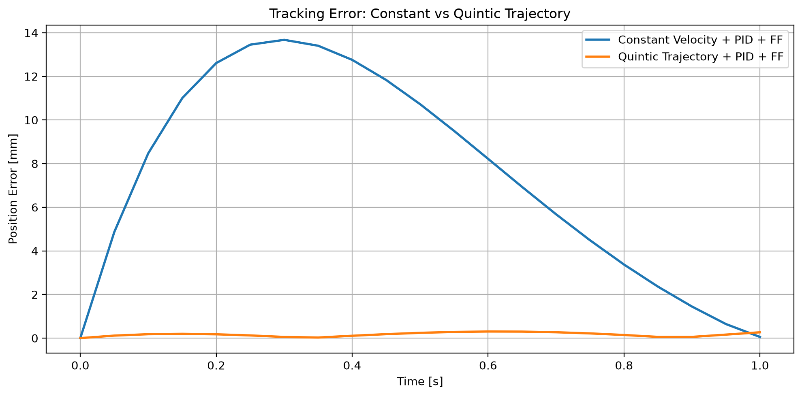

# 2リンクロボットアーム制御シミュレーター

Python・NumPy・Matplotlibで開発した、平面2リンクロボットアームの制御シミュレーターです。運動学と関節制御の基礎から、軌道追従、フィードフォワード制御、移動終了後の位置保持までを、数値計算とグラフで確認できます。

主な実験では、先端を `(1.2, 0.8) m` から `(1.3, 0.8) m` へ1秒間で移動させ、等速軌道と5次多項式軌道の追従誤差・保持誤差を比較しています。

## 実装内容

| 項目 | 実装・確認内容 |
| --- | --- |
| 順運動学 | `forward_kinematics()` で、関節角度から第1リンクの先端とアーム先端のXY座標を計算します。 |
| 逆運動学 | `inverse_kinematics()` で目標座標から関節角度を求めます。到達可能範囲を判定し、範囲外では `ValueError` を送出します。第2関節角度が0以上になる解を使用します。 |
| ヤコビ行列 | `calculate_jacobian()` で2×2行列を計算し、関節角速度から先端速度への変換、微小な位置誤差の予測、逆速度運動学に使用します。 |
| P・PD・PID制御 | 角速度指令によるP制御と、慣性・粘性減衰を考慮したトルク指令によるP・PD・PID制御を実装しています。トルク制御の第2関節比較では、共通の外乱トルク `−0.1 N·m` を加えています。 |
| 整定時間・ゲイン比較 | 関節角度が初期誤差の2%以内に入り、以降の全記録点でも範囲内にある時刻を評価します。固定目標への先端位置には20 mmの許容誤差を使用します。候補ゲインの走査によるオーバーシュート・整定時間の比較も行います。 |
| フィードフォワード制御 | 目標関節角速度・角加速度からモデルに基づくトルクを計算し、PIDのフィードバックトルクに加えます。 |
| 5次多項式による軌道生成 | 始点・終点の目標速度と目標加速度がゼロになる軌道を生成し、逆運動学とヤコビ行列から関節の目標値へ変換します。 |
| 位置保持 | 追従終了時の関節角度・角速度・積分誤差・前回誤差を引き継ぎ、最終目標をPID制御のみで1秒間保持します。 |
| 数値計算・可視化 | 逆速度運動学のEuler法とRK2中点法の比較、速度の差分近似の確認、誤差グラフ、固定目標へのPID応答のアニメーションを含みます。 |

順運動学で使用する先端座標は次の式です。角度は内部ではrad、リンク長と座標はmで扱います。

```text
x = L1 cos(θ1) + L2 cos(θ1 + θ2)
y = L1 sin(θ1) + L2 sin(θ1 + θ2)
```

ヤコビ行列はこの座標式の関節角度に関する偏微分です。`先端速度 = J(θ) × 関節角速度` として計算し、目標先端速度から関節角速度を求める際は `np.linalg.solve()` を使用します。

直線運動の運動学計算では、現在の姿勢で速度を評価するEuler法と、中点の姿勢で再評価するRK2中点法を比較します。時間刻みを変えた終点誤差の比較も実行します。

## 動力学モデルと制御

関節ごとに一定の慣性と粘性減衰を持つ、独立した簡易モデルを使用しています。

```text
角加速度 = (入力トルク − 粘性減衰係数 × 関節角速度) / 慣性
FFトルク = 慣性 × 目標関節角加速度 + 粘性減衰係数 × 目標関節角速度
入力トルク = PIDトルク + FFトルク
```

軌道追従のPIDは、目標角度と実際の角度の差、その積分、誤差の差分からトルクを計算します。固定目標のトルク制御実験では、D項に関節角速度を使用しています。動力学の時間更新は、角速度を更新してから角度を更新する半陰的Euler法です。

## 軌道追従・位置保持実験

比較する2方式は、どちらもPID＋フィードフォワード制御を使用します。

| 条件 | 設定 |
| --- | --- |
| リンク長 | `L1 = 1.0 m`、`L2 = 0.8 m` |
| 移動区間 | `(1.2, 0.8) m` → `(1.3, 0.8) m` |
| 追従時間 | 0〜1秒 |
| 保持時間 | 1〜2秒、最終目標 `(1.3, 0.8) m` を保持 |
| 計算刻み | 0.05秒（追従・保持それぞれ端点を含む21点） |
| PIDゲイン | `Kp = 1.2`、`Ki = 0.3`、`Kd = 0.4` |
| 各関節の慣性・粘性減衰係数 | `0.1 kg·m²`、`0.05 N·m·s/rad` |
| 追従開始時の状態 | 軌道始点の関節角度、角速度・積分誤差・前回誤差はゼロ |
| 外乱 | この軌道比較実験では外乱トルクを加えていません。 |

等速軌道は `x(t) = 1.2 + 0.1t`、`y(t) = 0.8` とし、移動中の目標先端速度を `0.1 m/s` に設定します。

5次多項式軌道は、`T = 1.0 s`、`s = t / T` として次の式で生成します。

```text
x(t) = 1.2 + 0.1 × (10s³ − 15s⁴ + 6s⁵)
y(t) = 0.8
```

この軌道では、始点・終点の目標速度と目標加速度をゼロにしています。等速軌道の目標関節角加速度は `np.gradient()` による数値微分で求め、5次多項式軌道では先端の目標加速度と `calculate_jacobian_dot()` によるヤコビ行列の時間微分を使って求めます。

保持実験では、追従終了時の状態を継続して最終目標を固定します。保持開始時の先端速度もヤコビ行列から算出しています。

## 実験結果

位置誤差は、目標と実際の先端位置のユークリッド距離をmmに換算した値です。最大位置誤差・平均位置誤差は0〜1秒の追従結果、保持中の最大位置誤差・2秒時点の位置誤差は1〜2秒の保持結果です。最大値は記録点での最大値、平均値は追従時の21点の算術平均を示します。1秒時点の先端速度は、追従終了時の実際の速度ベクトルの大きさをmm/sで示します。

| 指標 | 等速軌道 | 5次多項式軌道 |
| --- | ---: | ---: |
| 最大位置誤差 | 13.6747 mm | 0.3029 mm |
| 平均位置誤差 | 7.4047 mm | 0.1647 mm |
| 1秒時点の先端速度 | 113.5824 mm/s | 0.1818 mm/s |
| 保持中の最大位置誤差 | 15.9937 mm | 0.2672 mm |
| 2秒時点の位置誤差 | 1.7713 mm | 0.0216 mm |

この実験条件では、5次多項式軌道で追従時・保持時の位置誤差と、1秒時点の先端速度が小さくなりました。この比較には、軌道形状に加え、フィードフォワード用の目標関節角加速度の計算方法（等速側は数値微分、5次側はヤコビ行列の時間微分を用いた計算）の違いも含まれます。本結果は、これらを組み合わせた現在の実験条件における改善を示しています。



グラフは0〜1秒の追従中の位置誤差を表示しています。

## 使用技術

| 技術 | 用途 |
| --- | --- |
| Python 3 | シミュレーションの実行 |
| NumPy | 三角関数、行列演算、連立方程式、数値微分、履歴データの集計 |
| Matplotlib | グラフ描画、アームのアニメーション、比較画像の保存 |
| pathlib（標準ライブラリ） | 画像出力先の作成とパスの操作 |

表の数値の照合には、Python 3.13.17、NumPy 2.5.4、Matplotlib 3.11.2を使用しました。

## 実行方法

Tkinterが利用できるPython 3と、画面表示が可能なデスクトップ環境を用意してください。現在のコードにはTk固有のウィンドウ操作があるため、Matplotlibの `TkAgg` バックエンドを使用します。

WindowsのPowerShellで、プロジェクトのルートディレクトリから実行する例です。

```powershell
py -m venv .venv
.\.venv\Scripts\python.exe -m pip install numpy matplotlib
$env:MPLBACKEND = "TkAgg"
.\.venv\Scripts\python.exe main.py
```

`main.py` を実行すると、各実験の数値がターミナルに出力され、アニメーションと複数のグラフが表示されます。Step 5-22の比較グラフは `assets/trajectory_tracking_comparison.png` に保存され、同名の画像がある場合は更新されます。

## ファイル構成

```text
robot-arm-simulator/
├── main.py                      # 実験条件、実験の実行、グラフ作成
├── robot_arm/
│   ├── __init__.py
│   ├── kinematics.py            # 順・逆運動学、ヤコビ行列と時間微分
│   ├── metrics.py               # 関節角度の整定時間
│   ├── simulation.py            # PID応答、RK2直線運動
│   └── visualization.py         # アニメーションのフレーム更新
├── tests/baseline/
│   ├── capture.py               # GUIなしで候補データを取得
│   ├── compare.py               # 固定した基準データとの比較
│   └── reference/              # モジュール化前の基準データ
├── README.md
└── assets/
    └── trajectory_tracking_comparison.png
```

`main.py` では、逆運動学の動作確認、Euler直線運動・時間刻み比較、RK2単独・時間刻み比較を5つの実験関数に整理しています。軌道追従・保持などの実験とグラフ描画は引き続き `main.py` にあります。アニメーションは、後から生成される角度履歴をコールバックで取得します。

## 回帰テスト

既存画像を上書きせず、固定した基準データと結果を比較できます。出力先 `candidate` は未作成のディレクトリを指定してください。再実行時は別の新しい名前を使います。

```powershell
.\.venv\Scripts\python.exe tests\baseline\capture.py --output tests\baseline\candidate
.\.venv\Scripts\python.exe tests\baseline\compare.py tests\baseline\reference tests\baseline\candidate --exact
```

`--exact` で241配列・主要指標・16図の描画情報を比較します。標準出力・標準エラー・比較PNGのバイト列は別途照合します。取得方法と保存データの説明は [tests/baseline/README.md](tests/baseline/README.md) を参照してください。`reference/` は再生成せず維持します。

通常ウィンドウの表示内容と両関節の動きについて、人間による目視確認は未完了です。GUIの自動実行・座標検証と目視確認は区別しています。

## モデルの制約

**このシミュレーションは簡易動力学モデルを使用しており、実機のロボットアームと同じ精度を保証するものではありません。**

モデルには重力、関節間の動力学的な結合、コリオリ力・遠心力などを含めていません。モータモデルや、関節角度・角速度・トルクの制限も未実装です。表の値は、記載したモデル・ゲイン・時間刻み・軌道条件での数値計算結果です。条件を変えた場合や実機での性能を示すものではありません。

## 今後の改善点

以下は今後の改善候補です。

- 残る実験処理・軌道生成・描画の分割を進め、実験条件を設定しやすくする。
- 重力や関節間干渉を含む動力学モデルへ拡張する。
- 関節角度・角速度・トルクの制限を取り入れる。
- ヤコビ行列の特異姿勢付近での数値的な安定性を改善する。
- 運動学の往復計算や整定時間の判定を自動検証し、時間刻み・ゲインを変えた実験を整理する。
