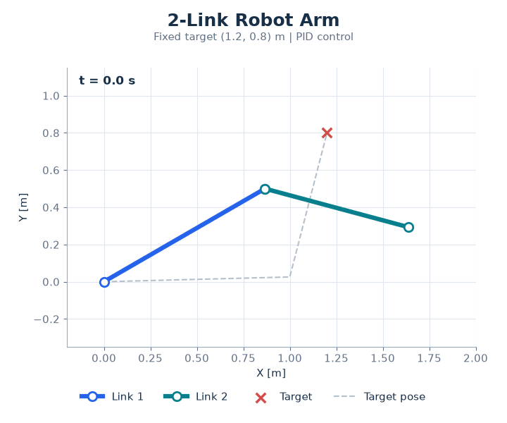
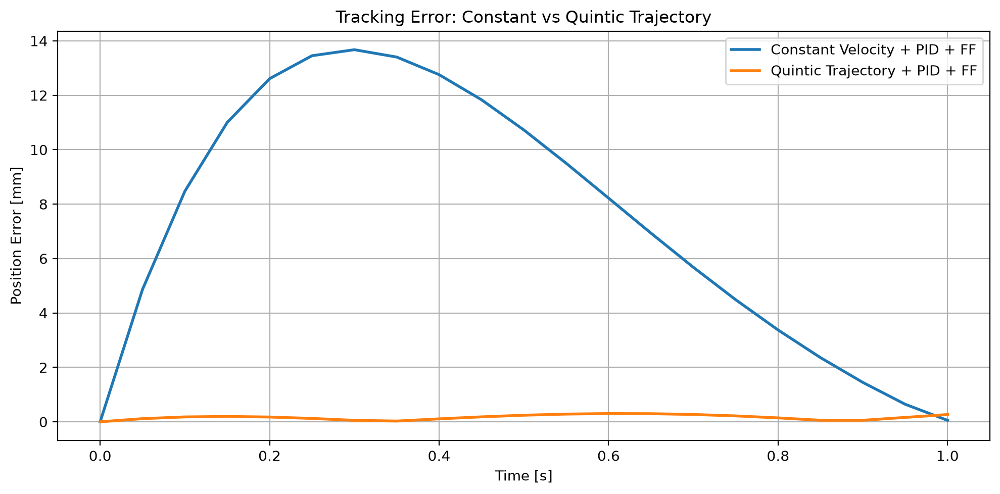
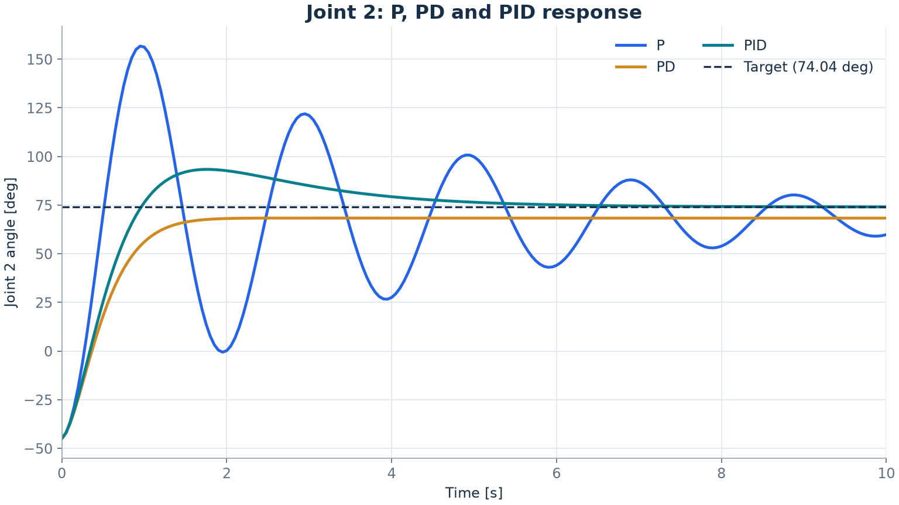
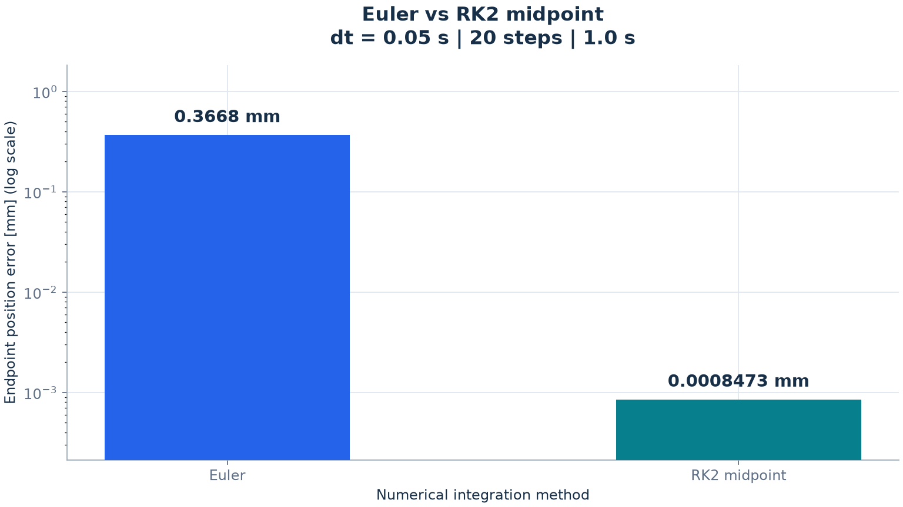
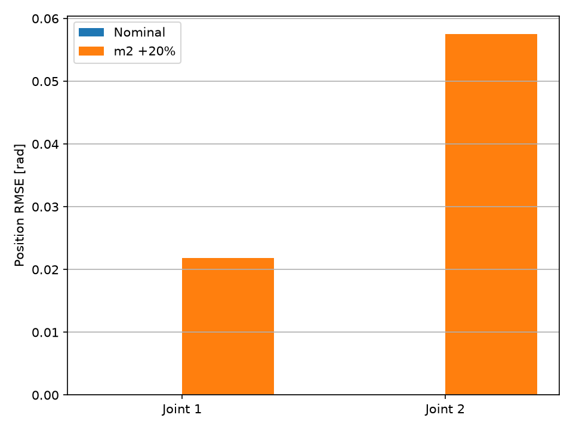
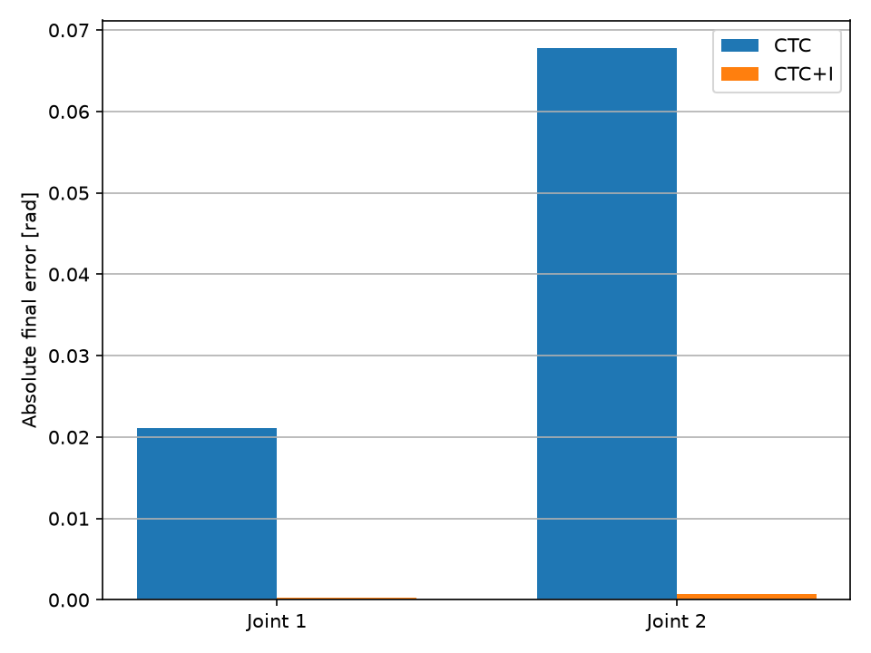
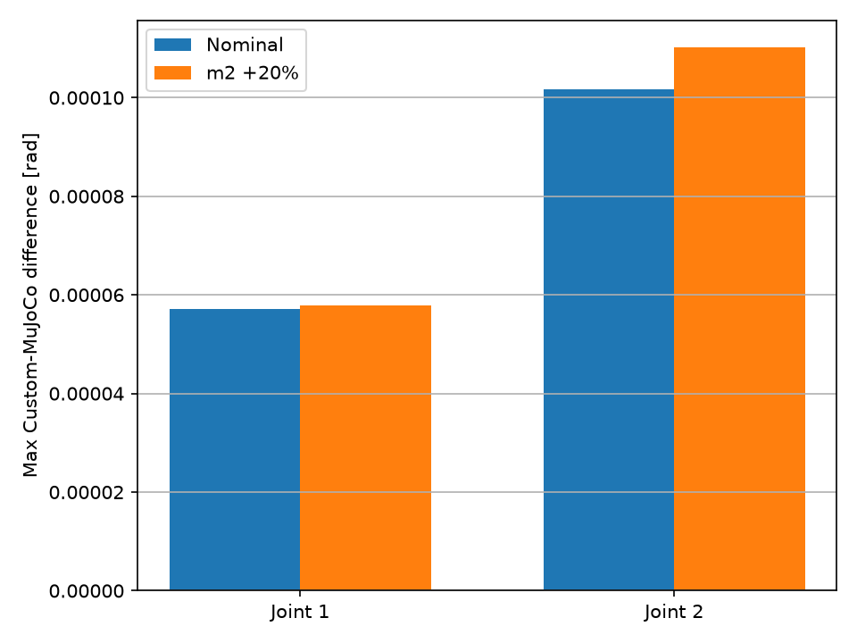

# 2リンクロボットアーム制御シミュレーター

Python・NumPy・Matplotlib・MuJoCoで開発した、平面2リンクロボットアームの制御シミュレーターです。順・逆運動学、P・PD・PID制御から始め、2リンク連成動力学、Computed Torque Control、モデル誤差、トルク飽和、積分制御、anti-windupまで段階的に実装しています。

自作した2リンク動力学モデルと制御器はMuJoCo上でも検証し、5次多項式軌道の追従性能、モデル誤差に対するCTCの感度、CTC+Iによる移動終了後の角度誤差の低減、トルク飽和時のwindupとanti-windupを定量評価しています。さらに、自作動力学シミュレータとMuJoCoのクロスバリデーションを行い、nominal条件では最大関節角度差が約 `1.02e-4 rad` となることを確認しました。

主な実験では、先端を `(1.2, 0.8) m` から `(1.3, 0.8) m` へ1秒間で移動させ、等速軌道と5次多項式軌道の追従誤差・保持誤差を比較しています。

## デモ



固定目標 `(1.2, 0.8) m` に対するPID制御応答です。既存のFigure 1と同じ第1関節PID履歴・第2関節の最適化後PID履歴を使い、0〜10秒の動作を再現しています。
灰色破線の `Target pose` は、逆運動学で求めた目標姿勢を示します。

## 主な実験結果



等速軌道と5次多項式軌道をPID＋フィードフォワード制御で追従した、0〜1秒の位置誤差を比較しています。軌道形状に加え、FF用角加速度の計算方法の違いも含む実験結果です。



共通の簡易動力学モデルと外乱トルク `−0.1 N·m` に対する、第2関節のP・PD・PID応答です。この図のPIDは最適化前の固定ゲインで、上のGIFには第2関節の最適化後の履歴を使用しています。



同じ直線運動を `dt = 0.05 s`、20ステップ、1秒間計算した終点誤差です。差が読み取れるよう縦軸を対数目盛とし、各方式の誤差をmmの数値ラベルで示しています。

## 実装内容

| 項目 | 実装・確認内容 |
| --- | --- |
| 順運動学 | `forward_kinematics()` で、関節角度から第1リンクの先端とアーム先端のXY座標を計算します。 |
| 逆運動学 | `inverse_kinematics()` で目標座標から関節角度を求めます。到達可能範囲を判定し、範囲外では `ValueError` を送出します。第2関節角度が0以上になる解を使用します。 |
| ヤコビ行列 | `calculate_jacobian()` で2×2行列を計算し、関節角速度から先端速度への変換、微小な位置誤差の予測、逆速度運動学に使用します。 |
| P・PD・PID制御 | 角速度指令によるP制御と、慣性・粘性減衰を考慮したトルク指令によるP・PD・PID制御を実装しています。トルク制御の第2関節比較では、共通の外乱トルク `−0.1 N·m` を加えています。 |
| 整定時間・ゲイン比較 | 関節角度が初期誤差の2%以内に入り、以降の全記録点でも範囲内にある時刻を評価します。固定目標への先端位置には20 mmの許容誤差を使用します。候補ゲインの走査によるオーバーシュート・整定時間の比較も行います。 |
| フィードフォワード制御 | 目標関節角速度・角加速度からモデルに基づくトルクを計算し、PIDのフィードバックトルクに加えます。 |
| 5次多項式による軌道生成 | 始点・終点の目標速度と目標加速度がゼロになる軌道を生成し、逆運動学とヤコビ行列から関節の目標値へ変換します。 |
| 位置保持 | 追従終了時の関節角度・角速度・積分誤差・前回誤差を引き継ぎ、最終目標をPID制御のみで1秒間保持します。 |
| 数値計算・可視化 | 逆速度運動学のEuler法とRK2中点法の比較、速度の差分近似の確認、誤差グラフ、固定目標へのPID応答のアニメーションを含みます。 |

順運動学で使用する先端座標は次の式です。角度は内部ではrad、リンク長と座標はmで扱います。

```text
x = L1 cos(θ1) + L2 cos(θ1 + θ2)
y = L1 sin(θ1) + L2 sin(θ1 + θ2)
```

ヤコビ行列はこの座標式の関節角度に関する偏微分です。`先端速度 = J(θ) × 関節角速度` として計算し、目標先端速度から関節角速度を求める際は `np.linalg.solve()` を使用します。

直線運動の運動学計算では、現在の姿勢で速度を評価するEuler法と、中点の姿勢で再評価するRK2中点法を比較します。時間刻みを変えた終点誤差の比較も実行します。

## 動力学モデルと制御

`main.py` の従来のPID実験では、関節ごとに一定の慣性と粘性減衰を持つ、独立した簡易モデルを使用しています。以下の式と時間更新はこのモデルの説明です。2リンク連成動力学とCTCについては後述します。

```text
角加速度 = (入力トルク − 粘性減衰係数 × 関節角速度) / 慣性
FFトルク = 慣性 × 目標関節角加速度 + 粘性減衰係数 × 目標関節角速度
入力トルク = PIDトルク + FFトルク
```

軌道追従のPIDは、目標角度と実際の角度の差、その積分、誤差の差分からトルクを計算します。固定目標のトルク制御実験では、D項に関節角速度を使用しています。動力学の時間更新は、角速度を更新してから角度を更新する半陰的Euler法です。

## 軌道追従・位置保持実験

比較する2方式は、どちらもPID＋フィードフォワード制御を使用します。

| 条件 | 設定 |
| --- | --- |
| リンク長 | `L1 = 1.0 m`、`L2 = 0.8 m` |
| 移動区間 | `(1.2, 0.8) m` → `(1.3, 0.8) m` |
| 追従時間 | 0〜1秒 |
| 保持時間 | 1〜2秒、最終目標 `(1.3, 0.8) m` を保持 |
| 計算刻み | 0.05秒（追従・保持それぞれ端点を含む21点） |
| PIDゲイン | `Kp = 1.2`、`Ki = 0.3`、`Kd = 0.4` |
| 各関節の慣性・粘性減衰係数 | `0.1 kg·m²`、`0.05 N·m·s/rad` |
| 追従開始時の状態 | 軌道始点の関節角度、角速度・積分誤差・前回誤差はゼロ |
| 外乱 | この軌道比較実験では外乱トルクを加えていません。 |

等速軌道は `x(t) = 1.2 + 0.1t`、`y(t) = 0.8` とし、移動中の目標先端速度を `0.1 m/s` に設定します。

5次多項式軌道は、`T = 1.0 s`、`s = t / T` として次の式で生成します。

```text
x(t) = 1.2 + 0.1 × (10s³ − 15s⁴ + 6s⁵)
y(t) = 0.8
```

この軌道では、始点・終点の目標速度と目標加速度をゼロにしています。等速軌道の目標関節角加速度は `np.gradient()` による数値微分で求め、5次多項式軌道では先端の目標加速度と `calculate_jacobian_dot()` によるヤコビ行列の時間微分を使って求めます。

保持実験では、追従終了時の状態を継続して最終目標を固定します。保持開始時の先端速度もヤコビ行列から算出しています。

## 実験結果

位置誤差は、目標と実際の先端位置のユークリッド距離をmmに換算した値です。最大位置誤差・平均位置誤差は0〜1秒の追従結果、保持中の最大位置誤差・2秒時点の位置誤差は1〜2秒の保持結果です。最大値は記録点での最大値、平均値は追従時の21点の算術平均を示します。1秒時点の先端速度は、追従終了時の実際の速度ベクトルの大きさをmm/sで示します。

| 指標 | 等速軌道 | 5次多項式軌道 |
| --- | ---: | ---: |
| 最大位置誤差 | 13.6747 mm | 0.3029 mm |
| 平均位置誤差 | 7.4047 mm | 0.1647 mm |
| 1秒時点の先端速度 | 113.5824 mm/s | 0.1818 mm/s |
| 保持中の最大位置誤差 | 15.9937 mm | 0.2672 mm |
| 2秒時点の位置誤差 | 1.7713 mm | 0.0216 mm |

この実験条件では、5次多項式軌道で追従時・保持時の位置誤差と、1秒時点の先端速度が小さくなりました。この比較には、軌道形状に加え、フィードフォワード用の目標関節角加速度の計算方法（等速側は数値微分、5次側はヤコビ行列の時間微分を用いた計算）の違いも含まれます。本結果は、これらを組み合わせた現在の実験条件における改善を示しています。

## 2リンク連成動力学とComputed Torque Control

簡易な独立関節モデルに加えて、鉛直平面内で動く2リンクロボットアームの連成動力学モデルを実装しています。

運動方程式は次の形で扱います。

```text
M(q) q̈ + c(q, q̇) + g(q) + B q̇ = τ
```

ここで、

- `M(q)`：慣性行列
- `c(q, q̇)`：コリオリ力・遠心力によるトルク
- `g(q)`：重力トルク
- `B q̇`：粘性抵抗
- `τ`：関節トルク

です。

`robot_arm/dynamics.py` に質量行列、コリオリ・遠心力ベクトル、重力ベクトル、順動力学を実装し、Euler法およびRK2中点法による数値積分を行います。

### Computed Torque Control

非線形な2リンク動力学を補償するため、Computed Torque Control（CTC）を実装しています。

静止目標に対しては、仮想加速度

```text
v = Kp (q_target - q) - Kd q̇
```

を計算し、

```text
τ = M(q) v + c(q, q̇) + g(q)
```

として関節トルクを求めます。

軌道追従では目標角度、目標角速度、目標角加速度を用いて、

```text
v =
q̈_des
+ Kd (q̇_des - q̇)
+ Kp (q_des - q)
```

としています。

5次多項式軌道を用いることで、開始時・終了時の目標速度と目標加速度がゼロになる滑らかな点-to-点運動を生成しています。

## MuJoCoによる外部物理エンジン検証

自作した2リンク動力学モデルと制御器を、MuJoCoを用いて別の物理エンジン上でも検証しました。

MuJoCoモデルには2つの回転関節を持つ2リンクアームを定義し、`qpos` と `qvel` から関節状態を取得します。制御器が計算した関節トルクは `qfrc_applied` を通じてMuJoCoへ入力します。

検証では以下を実施しました。

- 重力下での自由運動
- 関節トルクの直接入力
- Computed Torque Controlによる固定姿勢制御
- 正弦波軌道追従
- 5次多項式による滑らかな軌道追従
- 追従RMSE、最大誤差、最大トルクの定量評価
- 制御器内部の第2リンク質量 `m2` に対するモデル誤差検証
- CTC+Iによる移動終了後の角度誤差の低減
- トルク飽和によるintegrator windupの再現
- Conditional Integrationによるanti-windup
- 関節別Conditional Integration
- Back-calculation
- 自作動力学モデルとMuJoCoのクロスバリデーション

### Nominal軌道追従

5次多項式で `[0.0, 0.0] rad` から `[0.3, -0.4] rad` へ4秒間で移動させた結果、MuJoCo上のCTCで次の位置追従RMSEを得ました。集計区間は移動後の保持を含む0〜5秒です。

| 指標 | Joint 1 | Joint 2 |
| --- | --- | --- |
| Position RMSE | `2.56e-5 rad` | `3.42e-5 rad` |
| Maximum position error | `3.99e-5 rad` | `5.32e-5 rad` |
| Final position error | `7.56e-7 rad` | `-1.01e-6 rad` |
| Maximum torque | `16.03 N·m` | `3.17 N·m` |

この条件では、目標軌道と実際の関節角度はグラフ上でほぼ重なりました。

### モデル誤差に対するCTCの感度

MuJoCo側の実プラントを変更せず、CTC内部で使用する第2リンク質量 `m2` のみを変更してモデル誤差を与えました。

`m2` を20%過大評価した場合、Position RMSEは次のように増加しました。

| 条件 | Joint 1 RMSE | Joint 2 RMSE |
| --- | --- | --- |
| Nominal | `2.56e-5 rad` | `3.42e-5 rad` |
| `m2 +20%` | `0.0218 rad` | `0.0575 rad` |



さらに `m2` のモデル誤差を `-50%` から `+50%` まで5%刻みで走査し、モデル誤差が増えるにつれて追従性能が劣化することを確認しました。

今回の条件では、`m2` を過小評価した場合の方が過大評価した場合より追従性能の悪化が大きくなりました。

### CTC+I

モデル誤差によって移動終了後にも残る角度誤差を低減するため、CTCへ積分項を追加しました。

`m2 +20%` の条件では、10秒時点の最終位置誤差が、

```text
CTC
Joint 1: -0.0211 rad
Joint 2: -0.0678 rad
```

から、

```text
CTC+I
Joint 1: -0.00030 rad
Joint 2: -0.00074 rad
```

まで低減しました。



この比較は10秒時点の誤差を評価したもので、漸近的な定常偏差がゼロになることを証明するものではありません。

### トルク飽和とAnti-Windup

関節トルクを

```text
Joint 1: ±10 N·m
Joint 2: ±2 N·m
```

に制限し、CTC+Iを実行することでintegrator windupを再現しました。

飽和中にも通常の積分を続けた場合、最大要求トルクは、

```text
Joint 1: 121.45 N·m
Joint 2: 32.84 N·m
```

まで増加しましたが、MuJoCoへ入力される実トルクはそれぞれ `10 N·m`、`2 N·m` に制限されます。

この条件に対して、

- 全関節同時停止型Conditional Integration
- 関節別Conditional Integration
- Back-calculation

を比較しました。

Conditional Integrationでは積分蓄積を抑制できました。また、関節別方式では、飽和していない関節の積分更新を継続できることを確認しました。

Back-calculationでは `Kaw = 0.5, 1, 2, 5, 10` を比較し、今回の条件ではJoint 2のRMSEが比較した候補中で `Kaw = 5` のとき最小となりました。この結果は現在のゲイン・トルク制限・軌道・モデル誤差に依存します。

なお、`±10 N·m`、`±2 N·m` のトルク制限では目標姿勢を保持するために必要な重力補償トルク自体が不足するため、anti-windupだけで追従誤差をゼロにすることはできません。

## 自作動力学モデルとMuJoCoのクロスバリデーション

自作の2リンク動力学モデルとMuJoCoに対して、同じ軌道、同じCTC、同じ時間刻み `0.002 s` を使用して結果を比較しました。



### Nominal

自作モデルとMuJoCoの最大関節角度差は、

```text
Joint 1: 5.71e-5 rad
Joint 2: 1.02e-4 rad
```

でした。

### `m2 +20%` のモデル誤差

モデル誤差を与えた場合でも、Position RMSEは、

```text
Custom simulator
Joint 1: 0.0218088 rad
Joint 2: 0.0575167 rad

MuJoCo
Joint 1: 0.0217984 rad
Joint 2: 0.0575440 rad
```

となり、追従性能の劣化傾向までよく一致しました。

この結果から、現在実装している2リンク動力学モデルとMuJoCoモデルは、今回検証した条件において高い整合性を示しました。完全一致ではなく、残る微小差には数値積分法やシミュレーションエンジン内部の実装差が含まれます。

## 使用技術

| 技術 | 用途 |
| --- | --- |
| Python 3 | シミュレーションの実行 |
| NumPy | 三角関数、行列演算、連立方程式、数値微分、履歴データの集計 |
| Matplotlib | グラフ描画、アームのアニメーション、比較画像の保存 |
| MuJoCo | 2リンクロボットの物理シミュレーション、自作動力学・制御器の外部検証 |
| Pillow | ポートフォリオ用GIFの書き出し |
| pathlib（標準ライブラリ） | 画像出力先の作成とパスの操作 |

表の数値の照合には、Python 3.13.17、NumPy 2.5.4、Matplotlib 3.11.2を使用しました。

## 実行方法

以下は `main.py` の実行手順です。Tkinterが利用できるPython 3と、画面表示が可能なデスクトップ環境を用意してください。`main.py` にはTk固有のウィンドウ操作があるため、Matplotlibの `TkAgg` バックエンドを使用します。

WindowsのPowerShellで、プロジェクトのルートディレクトリから実行する例です。

```powershell
py -m venv .venv
.\.venv\Scripts\python.exe -m pip install numpy matplotlib pillow
$env:MPLBACKEND = "TkAgg"
.\.venv\Scripts\python.exe main.py
```

`main.py` を実行すると、各実験の数値がターミナルに出力され、アニメーションと複数のグラフが表示されます。Step 5-22の比較グラフは `assets/trajectory_tracking_comparison.png` に保存され、同名の画像がある場合は更新されます。

## ポートフォリオ画像の生成

GIFとP・PD・PID／Euler・RK2の2図は、固定した `tests/baseline/reference/` の検証済みデータ（commit `6788e279`）から生成しています。次の独立スクリプトは `main.py` をimportせず、MatplotlibのAggとPillowで書き出します。

```powershell
.\.venv\Scripts\python.exe scripts\export_portfolio_assets.py
```

出力先は `assets/` です。`robot_arm_demo.gif`、`pid_response_comparison.png`、`euler_rk2_comparison.png` の3ファイルを生成・更新し、既存の軌道比較PNGと基準データは変更しません。`--output-dir` で別の出力先も指定できます。

GIFは既存のアニメーションと同じ101フレーム・10 fpsで、1周10.1秒の繰り返し再生です。各フレームのリンク座標は既存の `forward_kinematics()` で計算しています。

## ファイル構成

主なファイルを示します。

```text
robot-arm-simulator/
├── main.py                      # 実験条件、実験の実行、グラフ作成
├── robot_arm/
│   ├── __init__.py
│   ├── kinematics.py            # 順・逆運動学、ヤコビ行列と時間微分
│   ├── dynamics.py              # 2リンク連成動力学、順動力学、数値積分
│   ├── controllers.py           # PD制御、重力補償
│   ├── computed_torque.py       # 静止目標へのCTC
│   ├── computed_torque_integral.py # 積分項を加えたCTC
│   ├── actuator.py              # 関節トルクの制限
│   ├── metrics.py               # 関節角度の整定時間
│   ├── simulation.py            # PID応答、RK2直線運動
│   └── visualization.py         # アニメーションのフレーム更新
├── models/
│   ├── one_link_arm.xml         # MuJoCo用1リンクモデル
│   └── two_link_arm.xml         # MuJoCo用2リンクモデル
├── scripts/
│   ├── export_portfolio_assets.py # 固定基準データからGIF・代表グラフを生成
│   ├── run_coupled_dynamics_demo.py # 連成動力学の検証と物理パラメータ
│   ├── run_computed_torque_demo.py # PD＋重力補償とCTCの比較
│   ├── run_mujoco_visualization.py # MuJoCo Viewerでの軌道追従デモ
│   ├── evaluate_mujoco_trajectory_tracking.py # 軌道追従性能の評価
│   ├── evaluate_mujoco_model_mismatch.py # モデル誤差の評価
│   ├── sweep_mujoco_model_mismatch.py # モデル誤差率の走査
│   ├── evaluate_mujoco_ctc_integral.py # CTC+Iの評価
│   ├── evaluate_mujoco_windup.py # トルク飽和とwindupの評価
│   ├── evaluate_mujoco_anti_windup.py # 全関節同時停止型の評価
│   ├── evaluate_mujoco_per_joint_anti_windup.py # 関節別停止型の評価
│   ├── evaluate_mujoco_back_calculation.py # Back-calculationの評価
│   ├── compare_custom_vs_mujoco.py # 自作モデルとMuJoCoの比較
│   └── summarize_mujoco_validation.py # MuJoCo検証結果の集約
├── tests/baseline/
│   ├── capture.py               # GUIなしで候補データを取得
│   ├── compare.py               # 固定した基準データとの比較
│   └── reference/              # モジュール化前の基準データ
├── outputs/                     # 各実験のCSV・JSON・比較グラフ
├── README.md
└── assets/
    ├── trajectory_tracking_comparison.png
    ├── robot_arm_demo.gif
    ├── pid_response_comparison.png
    ├── euler_rk2_comparison.png
    ├── mujoco_tracking_rmse_summary.png
    ├── mujoco_integral_effect_summary.png
    └── mujoco_cross_validation_summary.png
```

`main.py` では、逆運動学の動作確認、Euler直線運動・時間刻み比較、RK2単独・時間刻み比較を5つの実験関数に整理しています。軌道追従・保持などの実験とグラフ描画は引き続き `main.py` にあります。アニメーションは、後から生成される角度履歴をコールバックで取得します。

## 回帰テスト

既存画像を上書きせず、固定した基準データと結果を比較できます。出力先 `candidate` は未作成のディレクトリを指定してください。再実行時は別の新しい名前を使います。

```powershell
.\.venv\Scripts\python.exe tests\baseline\capture.py --output tests\baseline\candidate
.\.venv\Scripts\python.exe tests\baseline\compare.py tests\baseline\reference tests\baseline\candidate --exact
```

`--exact` で241配列・主要指標・16図の描画情報を比較します。標準出力・標準エラー・比較PNGのバイト列は別途照合します。取得方法と保存データの説明は [tests/baseline/README.md](tests/baseline/README.md) を参照してください。`reference/` は再生成せず維持します。

通常ウィンドウの表示内容と両関節の動きについて、人間による目視確認は未完了です。GUIの自動実行・座標検証と目視確認は区別しています。

## モデルの制約

**本プロジェクトはシミュレーションによる制御検証を目的としており、実機ロボットでの性能を保証するものではありません。**

現在の2リンク動力学モデルには、慣性行列、関節間の動力学的結合、コリオリ力・遠心力、重力、粘性抵抗を含めています。また、外部トルク制限を用いたアクチュエータ飽和も検証しています。

一方で、モータの電気特性、ギア、バックラッシ、クーロン摩擦、センサノイズ、通信遅延、柔軟性、関節角度制限、衝突などは詳細にはモデル化していません。

MuJoCoとのクロスバリデーションでは現在の2リンクモデルと高い一致を確認していますが、これは記載したモデル構造・パラメータ・軌道・時間刻みに対する結果です。実機で同じ追従精度を得られることを意味するものではありません。

## 今後の改善点

今後の候補として、以下を検討しています。

- MuJoCo上で関節角度制限や接触を含む、より実機に近い条件を追加する。
- モータ・減速機・摩擦を含むアクチュエータモデルへ拡張する。
- センサノイズや通信遅延を加え、制御器のロバスト性を評価する。
- 軌道追従のViewerデモをGIFまたは動画としてポートフォリオ用に整理する。
- 既存のMuJoCo動力学・固定姿勢CTCテストに加え、5次多項式軌道・モデル誤差・anti-windupの検証結果も回帰テストへ追加し、将来の変更で動力学・制御性能が崩れていないか自動確認できるようにする。
- 実機ロボットアームへの展開を見据えて、制御ループとシミュレーション部分のインターフェースをさらに分離する。
