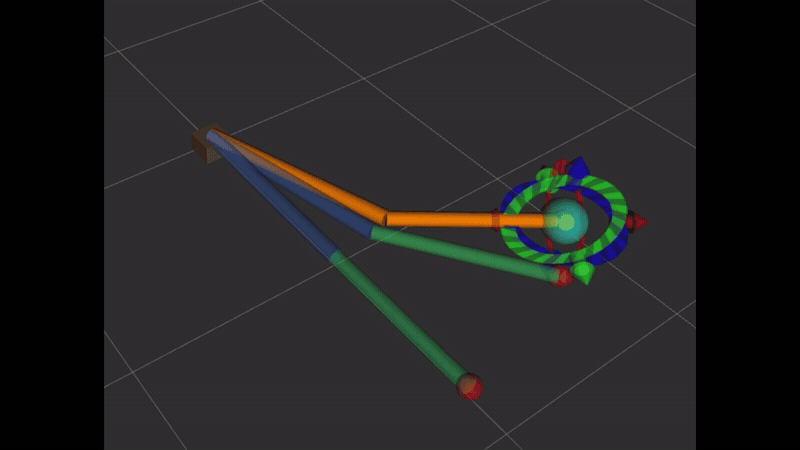
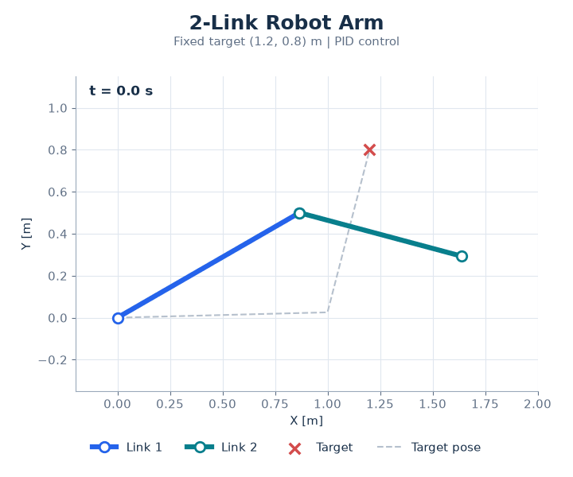
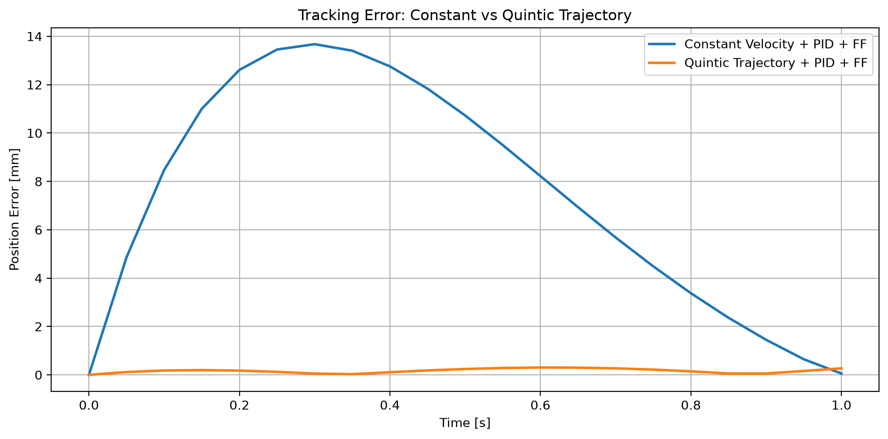
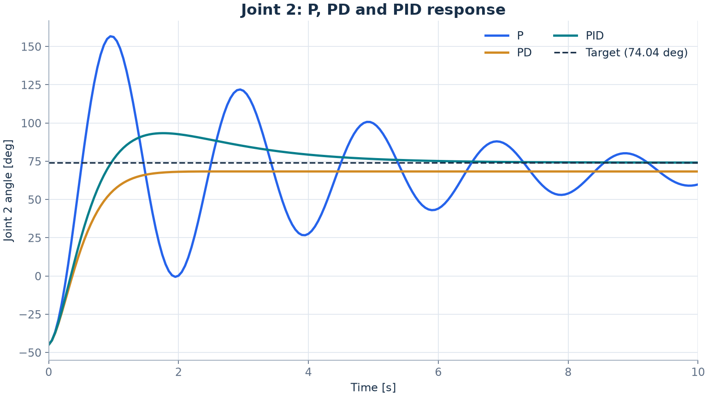
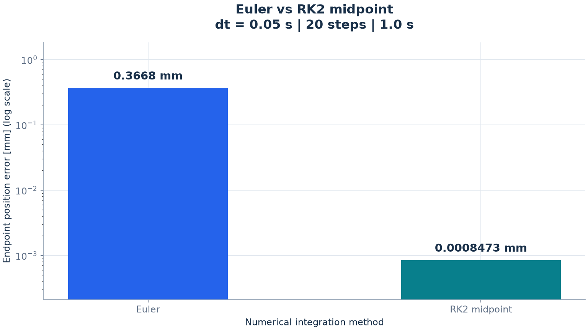
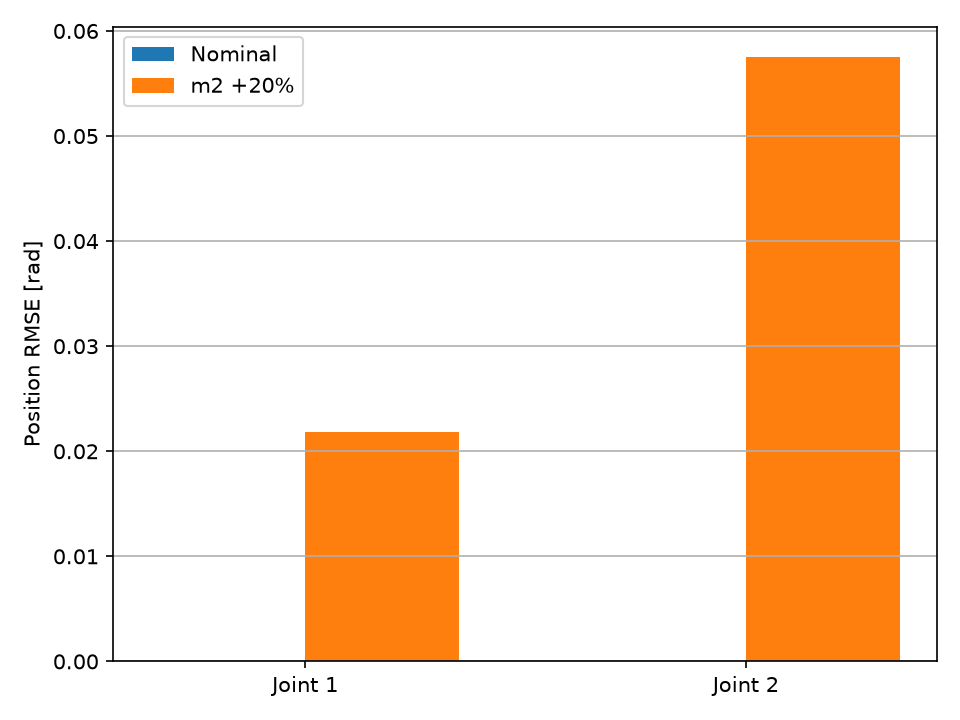
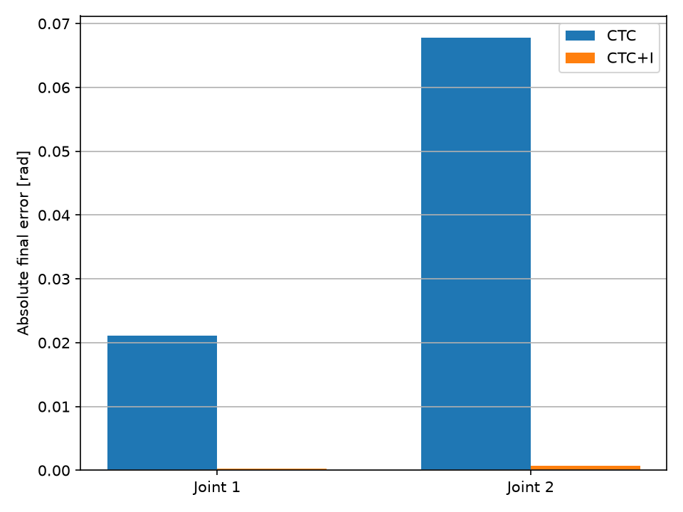

# Robot Arm Simulator

[](https://github.com/2114-takumi/robot-arm-simulator/actions/workflows/python-ci.yml)

MuJoCo上の2リンクロボットアームを題材に、**制御工学・コンピュータビジョン・模倣学習・ROS 2 / MoveIt 2・強化学習**を段階的に統合した個人開発プロジェクトです。

最初は順運動学・逆運動学とPID制御から開始し、その後、2リンク連成動力学、Computed Torque Control、カメラ画像を用いた到達制御、Behavioral Cloning / DAgger、ROS 2 / MoveIt 2との統合、PPOによるトルク制御まで発展させました。

## Demo: ROS 2 / MoveIt 2 → MuJoCo



RVizで指定した目標関節角に対してMoveIt 2が軌道を生成し、
`FollowJointTrajectory` Actionを自作Bridge Nodeで受信します。
Bridgeは軌道点を `/joint_command` へ変換し、
PD制御と重力・バイアス補償によってMuJoCoの2リンクアームを追従させます。

```text
RViz
  ↓
MoveIt 2 / OMPL
  ↓
FollowJointTrajectory
  ↓
Custom Trajectory Bridge
  ↓
/joint_command
  ↓
MuJoCo Robot Node
  ↓
/joint_states
  ↓
TF / RViz
```

## Key Results

| Experiment | Result |
| --- | --- |
| MuJoCo CTC tracking | Position RMSE — Joint 1: `2.56e-5 rad`, Joint 2: `3.42e-5 rad` |
| Vision Behavioral Cloning | 50 episodes success rate: **50%** |
| DAgger Round 1 | 50 episodes success rate: **76%** |
| PPO | 100 deterministic episodes; success rate: **95.0%**; mean final error: `0.0380 rad`; median final error: `0.0352 rad`; mean minimum error: `0.0289 rad` |

詳細は後半の各実験セクションおよび [docs/ppo_experiment.md](docs/ppo_experiment.md) を参照してください。

## Quick Start

以下は、cloneしたリポジトリのルートディレクトリを起点に実行します。

### A. Python / MuJoCo

Linux / WSL（Python 3とvenvが必要）：

```bash
python3 -m venv .venv
source .venv/bin/activate
python -m pip install --upgrade pip
python -m pip install -r requirements.txt
```

Windows PowerShellでは、最初の2行を次に置き換えてください。pipの2行は共通です。

```powershell
py -3 -m venv .venv
.\.venv\Scripts\Activate.ps1
```

基本の運動学・PID制御デモ（MatplotlibのGUIを使用）：

```bash
python main.py
```

MuJoCoのCTC軌道追従評価（checkpoint不要、結果画像は `outputs/step_8_22/` に保存）：

```bash
python scripts/evaluate_mujoco_trajectory_tracking.py
```

`requirements.txt` は制御・Vision・学習・テストで使用するPython依存をまとめています。プロジェクト全体の固定バージョン環境は定義されていないため、厳密なバージョン指定は行っていません。

### B. PPO

AのPython環境で初回学習（100k steps）を実行します。

```bash
python train_ppo.py
```

保存先は `models_rl/ppo_robot_arm.zip` です。一方、評価コードは **`models_rl/ppo_robot_arm_500k.zip` を読み込みます**。checkpoint（`models_rl/*.zip`）はGit管理対象外なので、clone直後や初回学習だけでは次の評価は実行できません。

500k checkpointを用意した後の評価（100 deterministic episodes）：

```bash
python evaluate_ppo.py
```

初回学習から評価用checkpointを作る場合は、初回学習の完了後に以下を順に実行します。継続学習コードの入力名に合わせて100kモデルをコピーし、300k相当、500k相当へ学習を進めます。

```bash
python -c "import shutil; shutil.copyfile('models_rl/ppo_robot_arm.zip', 'models_rl/ppo_robot_arm_100k.zip')"
python continue_ppo.py
python continue_ppo_500k.py
```

上記のKey Resultsは既存実験の記録であり、再学習による数値の一致を保証するものではありません。

### C. ROS 2 / MoveIt 2 → MuJoCo

対象は **Ubuntu 24.04 / WSL2、ROS 2 Jazzy、MoveIt 2、colcon** です。RVizを表示できるGUI環境が必要です。ROS 2 Jazzyのインストールと `rosdep init` が済んでいることを前提に、Aの環境を有効化していない新しいUbuntuターミナルで実行してください。

**起動前のパス確認：** 現在の [mujoco_joint_state_publisher.py](ros2_ws/src/robot_arm_ros/robot_arm_ros/mujoco_joint_state_publisher.py) の `model_path` は `/mnt/c/Users/cfca5399/Projects/personal/python/robot-arm-simulator/models/two_link_arm.xml` に固定されています。別の場所にcloneした場合は、この変数を実際の `models/two_link_arm.xml` の絶対パスへ合わせてからビルドする必要があります。

ROS依存はapt / rosdepで導入します。`rclpy`、メッセージ型、MoveIt、launch、ament等は `requirements.txt` に含めていません。

```bash
source /opt/ros/jazzy/setup.bash
sudo apt update
sudo apt install ros-jazzy-moveit python3-colcon-common-extensions python3-rosdep python3-venv
cd ros2_ws
rosdep update
rosdep install --from-paths src --ignore-src --rosdistro jazzy -y
```

MuJoCo用にROS専用の仮想環境を作成します。ROSのシステムPythonとapt導入済みパッケージを使用し、Aの学習用環境とは分離します（[ROS 2のPython環境ガイド](https://github.com/ros2/ros2_documentation/blob/jazzy/source/How-To-Guides/Using-Python-Packages.rst)）。

```bash
/usr/bin/python3 -m venv --system-site-packages .venv
source .venv/bin/activate
touch .venv/COLCON_IGNORE
python -m pip install mujoco numpy
python -c "import rclpy, mujoco, numpy"
python /usr/bin/colcon build --symlink-install
source install/setup.bash
ros2 launch robot_arm_moveit_config mujoco_moveit.launch.py
```

`python /usr/bin/colcon` は仮想環境のPythonでビルドするための指定です。launchは `robot_arm_ros` のMuJoCoノードと軌道Bridge、MoveItの `move_group`、TF、RVizを起動します。以後、新しいターミナルで起動するときも、ROS本体、`ros2_ws/.venv/bin/activate`、`ros2_ws/install/setup.bash` をこの順でsourceしてください。

## Project Overview

このプロジェクトでは、同じ2リンクロボットアームに対して複数の制御・学習手法を実装し、それぞれの特徴を比較しています。

```text
Classical Control
PID / CTC / Anti-Windup
        ↓
MuJoCo Physics Simulation
        ↓
Vision-to-Control
Camera → CNN → IK → CTC
        ↓
Imitation Learning
CTC Expert → BC → Vision Policy → DAgger
        ↓
ROS 2 / MoveIt 2
Motion Planning → FollowJointTrajectory → MuJoCo
        ↓
Reinforcement Learning
Gymnasium → PPO → Direct Torque Control
```

## System Architecture

### Vision + Control

```text
MuJoCo Camera
      ↓
RGB Image
      ↓
CNN
      ↓
Ball Position (x, y)
      ↓
Inverse Kinematics
      ↓
Target Joint Angles
      ↓
Quintic Trajectory
      ↓
Computed Torque Control
      ↓
Joint Torque
      ↓
MuJoCo
```

### Vision Imitation Learning

```text
RGB Image + q + dq
        ↓
Vision Policy
CNN + Proprioception MLP
        ↓
Joint Torque
        ↓
MuJoCo
```

推論時には、目標関節角、逆運動学、CTCをPolicyへ入力せず、画像と現在の関節状態だけから直接トルクを出力します。

### ROS 2 / MoveIt 2 Integration

```text
RViz
  ↓
MoveIt 2
  ↓
Motion Planning
  ↓
FollowJointTrajectory
  ↓
Custom ROS 2 Bridge
  ↓
/joint_command
  ↓
MuJoCo Robot Node
  ↓
PD + Gravity / Bias Compensation
  ↓
/joint_states
  ↓
robot_state_publisher
  ↓
TF
  ↓
RViz
```

### Reinforcement Learning

```text
Observation
[q1, q2, dq1, dq2, q1_goal, q2_goal]
        ↓
PPO Policy
        ↓
Normalized Action [-1, 1]
        ↓
Torque Scaling
        ↓
[tau1, tau2]
        ↓
MuJoCo
        ↓
Reward
```

---

# Experiment Details

## 1. Classical Control and MuJoCo Validation

順運動学・逆運動学・ヤコビ行列から実装を開始し、P / PD / PID制御、フィードフォワード制御、2リンク連成動力学、Computed Torque Controlまで実装しました。

主な実装内容：

- Forward / Inverse Kinematics
- Jacobian / Inverse Velocity Kinematics
- P / PD / PID Control
- Quintic Trajectory Generation
- Feedforward Control
- Coupled Two-Link Dynamics
- Computed Torque Control
- Integral Compensation
- Torque Saturation
- Conditional Integration
- Per-Joint Anti-Windup
- Back-Calculation
- Sensor Noise / Quantization
- Control Delay
- External Disturbances
- Model Mismatch Evaluation

### MuJoCo CTC Tracking

`[0.0, 0.0] rad` から `[0.3, -0.4] rad` への5次多項式軌道追従では、MuJoCo上で以下のRMSEを確認しました。

| Metric | Joint 1 | Joint 2 |
|---|---:|---:|
| Position RMSE | `2.56e-5 rad` | `3.42e-5 rad` |
| Max position error | `3.99e-5 rad` | `5.32e-5 rad` |
| Final position error | `7.56e-7 rad` | `-1.01e-6 rad` |

また、自作した2リンク動力学モデルとMuJoCoを同一入力条件で比較し、nominal条件では最大関節角差が約 `1.02e-4 rad` となることを確認しました。

### Model Mismatch

CTC内部の第2リンク質量を20%過大評価した場合：

| Condition | Joint 1 RMSE | Joint 2 RMSE |
|---|---:|---:|
| Nominal | `2.56e-5 rad` | `3.42e-5 rad` |
| `m2 +20%` | `0.0218 rad` | `0.0575 rad` |

モデル誤差によりCTC性能が劣化することを確認し、その後CTC+Iによって残留誤差を低減しました。

---

## 2. Vision-to-Control

MuJoCo Cameraから合成画像を取得し、CNNによって赤色ターゲットのXY位置を推定しました。

その後、

```text
Camera
→ CNN
→ Ball XY
→ IK
→ Quintic Trajectory
→ CTC
→ MuJoCo
```

を統合しました。

CNNによるボール位置推定は約 `3 cm RMSE`、統合後の先端-to-ball誤差は約 `1 cm` まで到達しました。

主なスクリプト：

```text
scripts/render_mujoco_rgb.py
scripts/generate_vision_dataset.py
scripts/vision_to_ik.py
scripts/vision_to_control.py
scripts/export_mujoco_dataset.py
```

---

## 3. Behavioral Cloning and DAgger

CTCをExpert Policyとしてデモデータを生成し、ニューラルネットワークにトルク出力を模倣させました。

### State-Based Behavioral Cloning

入力：

```text
[q1, q2, dq1, dq2, q1_goal, q2_goal]
```

出力：

```text
[tau1, tau2]
```

50エピソード評価では、State-based BCで約 `96%` の成功率を確認しました。

### Vision Policy

Vision Policyでは、

```text
RGB Image
+
[q1, q2, dq1, dq2]
```

のみを入力とし、

```text
[tau1, tau2]
```

を直接出力します。

推論時には以下を使用しません。

```text
q_goal
IK
CTC
```

初期のVision Behavioral Cloningでは50エピソード評価で成功率 `50%` となり、Policy自身が訪れる状態と教師データ分布のずれによる失敗が確認されました。

### DAgger

学生Policyが訪れた状態に対してCTC ExpertのActionを再ラベルし、データセットへ追加しました。

```text
Student Policy Rollout
        ↓
Student-Visited State
        ↓
CTC Expert Label
        ↓
Dataset Aggregation
        ↓
Retraining
```

DAgger Round 1後：

```text
Success rate: 76%
```

となり、Behavioral Cloning単体より大きく改善しました。

---

## 4. ROS 2 / MoveIt 2 Integration

ROS 2 Jazzy環境をWSL2 Ubuntu上に構築し、自作MuJoCoロボットをROS 2 / MoveIt 2へ接続しました。

実装した主な要素：

- ROS 2 Publisher / Subscriber
- `/joint_states`
- `/joint_command`
- URDF
- `robot_state_publisher`
- TF
- RViz
- ROS 2 Launch
- MoveIt 2 Setup Assistant
- OMPL Planning
- FollowJointTrajectory
- Custom MuJoCo Trajectory Bridge

MoveItで生成されたTrajectoryを自作Bridge Nodeで受信し、各Trajectory Pointを `/joint_command` へ変換してMuJoCoへ送信します。

```text
MoveIt
↓
/mujoco_arm_controller/follow_joint_trajectory
↓
mujoco_trajectory_bridge
↓
/joint_command
↓
MuJoCo
```

MuJoCo側では目標関節角に対してPD制御とMuJoCoのBias Force Compensationを行い、MoveItで指定した目標姿勢まで追従できることを確認しました。

ROS 2 packages：

```text
ros2_ws/src/robot_arm_ros/
ros2_ws/src/robot_arm_moveit_config/
```

---

## 5. PPO Reinforcement Learning

MuJoCoの2リンクアームをGymnasium環境として実装し、Stable-Baselines3のPPOを用いて直接トルク制御を学習しました。

### Observation

```text
[q1, q2, dq1, dq2, q1_goal, q2_goal]
```

### Action

PPOは正規化されたActionを出力します。

```text
[action1, action2] ∈ [-1, 1]
```

環境内部で実トルクへ変換します。

```text
tau1 = action1 × 30 Nm
tau2 = action2 × 15 Nm
```

### Reward

```text
reward =
    - position error
    - velocity penalty
    - torque penalty
    + success bonus
```

PPOにはCTC Expertの正解トルクを与えていません。

### Training Progress

| Training | Success Rate | Mean Final Error |
|---|---:|---:|
| 100k steps | 65% | `0.0755 rad` |
| 300k-equivalent | 70% | `0.0525 rad` |
| 500k-equivalent | **95%** | **`0.0380 rad`** |

最終モデルは100エピソードで評価しました。

```text
Success rate:        95.0%
Mean final error:    0.0380 rad
Median final error:  0.0352 rad
Mean minimum error:  0.0289 rad
```

平均最終誤差 `0.0380 rad` は約 `2.18°` です。

詳細：[docs/ppo_experiment.md](docs/ppo_experiment.md)

---

# Demo



固定目標に対するPID制御による2リンクアームのシミュレーションです。

## Classical Control Results

### 軌道追従誤差：等速軌道 vs 5次多項式軌道



**滑らかな5次多項式軌道を用いることで、等速軌道と比較して追従誤差を大幅に低減しました。**\
今回の比較には、軌道形状に加えてフィードフォワード用の目標関節角加速度の計算方法の違いも含まれています。

### 制御応答：P制御 vs PD制御 vs PID制御



**同じ動力学モデルと外乱条件で、P・PD・PID制御による第2関節の応答を比較しました。振動の抑制や目標角度に対する残留誤差など、各制御方式の特徴を確認できます。**

### 数値積分：Euler法 vs RK2中点法



**同じ運動をEuler法とRK2中点法で数値積分し、終点誤差を比較しました。中点で状態を再評価するRK2により、今回の条件ではEuler法より大幅に高い精度を確認しました。**

### MuJoCoでの軌道追従誤差：モデル誤差の影響



**MuJoCo上でCTCによる軌道追従を評価し、モデルが一致する条件では小さな追従誤差を確認しました。一方、制御器内部のリンク質量に誤差を与えると、関節角度のRMSEが増加しました。**

### モデル誤差下でのCTC vs CTC+I



**モデル誤差下でCTCに積分補償を加えることで、移動終了後に残る関節角度誤差を大幅に低減しました。**\
この比較では、第2リンク質量を20%過大評価した条件で、10秒時点の関節角度誤差を評価しています。

---

# Repository Structure

```text
robot-arm-simulator/
├── assets/
│
├── models/
│   ├── one_link_arm.xml
│   └── two_link_arm.xml
│
├── robot_arm/
│   └── control / dynamics modules
│
├── scripts/
│   ├── MuJoCo validation
│   ├── vision dataset generation
│   ├── vision-to-control
│   ├── behavioral cloning
│   └── DAgger evaluation
│
├── ros2_ws/
│   └── src/
│       ├── robot_arm_ros/
│       └── robot_arm_moveit_config/
│
├── docs/
│   ├── ppo_experiment.md
│   └── results/
│
├── robot_arm_rl_env.py
├── train_ppo.py
├── continue_ppo.py
├── continue_ppo_500k.py
├── evaluate_ppo.py
├── requirements.txt
│
└── main.py
```

---

# Technologies

### Robotics / Control

```text
Forward / Inverse Kinematics
Jacobian
PID
Feedforward Control
Computed Torque Control
Anti-Windup
Trajectory Generation
```

### Simulation

```text
MuJoCo
NumPy
Matplotlib
```

### Machine Learning

```text
PyTorch
CNN
Behavioral Cloning
DAgger
Gymnasium
Stable-Baselines3
PPO
```

### Robotics Software

```text
ROS 2 Jazzy
MoveIt 2
RViz
URDF
TF
FollowJointTrajectory
```

---

# What I Learned

このプロジェクトを通じて、単一の制御方式を実装するだけでなく、

```text
Model-Based Control
        ↕
Simulation
        ↕
Machine Learning
        ↕
Robot Software Architecture
```

を同じロボットシステム上で接続しました。

特に、

- 物理モデルを使う制御と学習ベース制御の違い
- SimulationとControllerの分離
- Behavioral CloningにおけるDistribution Shift
- DAggerによるStudent-Visited Stateの収集
- PPOにおけるReward設計とAction Normalization
- ROS 2におけるNode / Topic / Actionによるモジュール化
- MoveItによるMotion PlanningとLow-Level Controlの役割分担

を、実装と評価を通して学びました。

---

# Future Work

今後は以下を発展させる予定です。

- 実ロボットアームへの展開
- ROS 2と実機Servo Interfaceの統合
- Camera-based Reinforcement Learning
- Vision-Language-Action Models
- Tactile Sensing
- Sim-to-Real Transfer
- Domain Randomization
- RL / Imitation LearningとModel-Based Controlの統合

---

# Status

Current milestones:

```text
Kinematics                         ✅
PID / Feedforward Control          ✅
Coupled Dynamics                   ✅
Computed Torque Control            ✅
MuJoCo Validation                  ✅
Sensor / Delay / Disturbance       ✅
Vision-to-Control                  ✅
Behavioral Cloning                 ✅
Vision Policy                      ✅
DAgger                             ✅
ROS 2 / RViz / URDF                ✅
MoveIt 2 → MuJoCo                  ✅
PPO Reinforcement Learning         ✅
Real Robot                         ⬜
```
